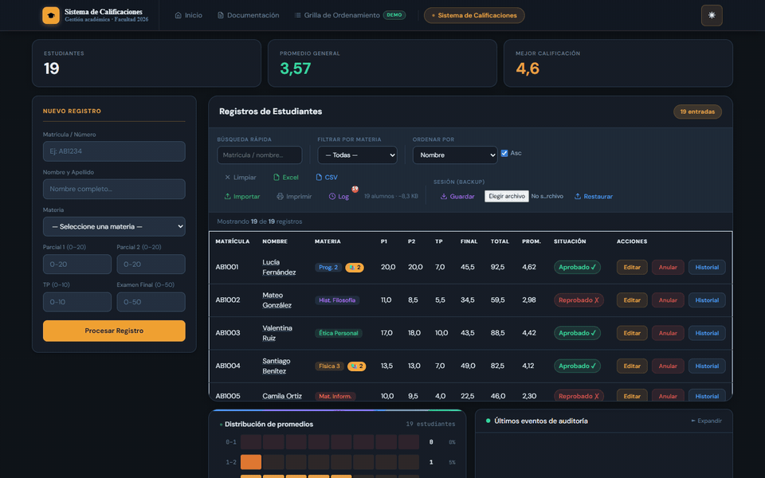
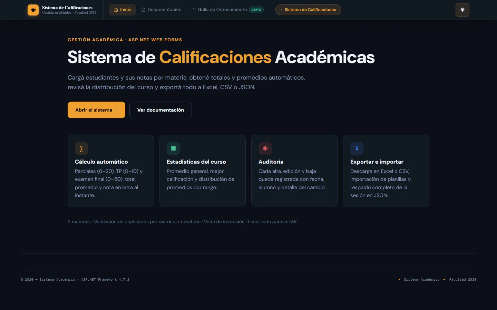
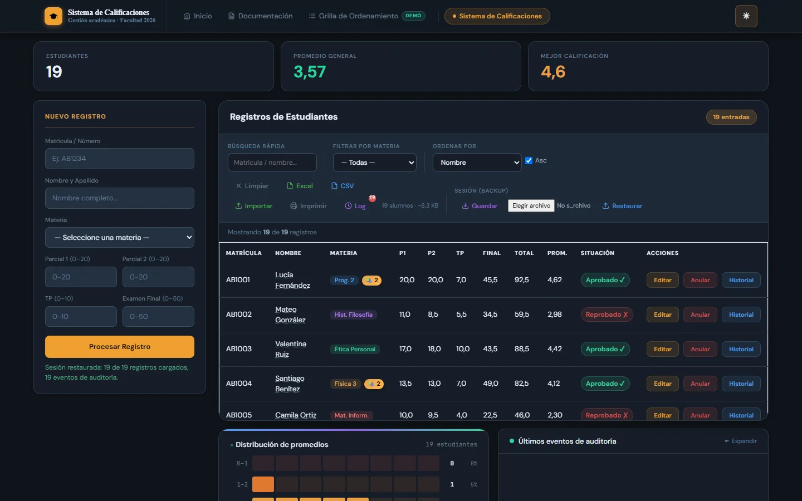
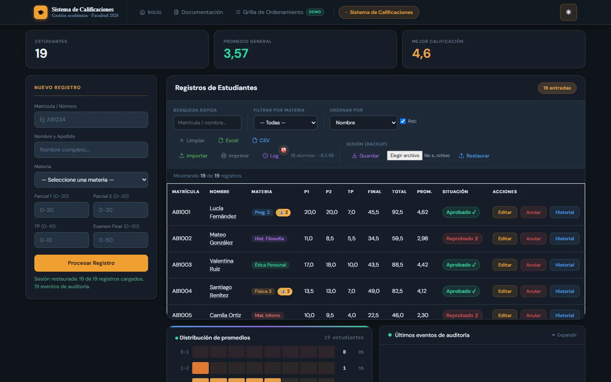
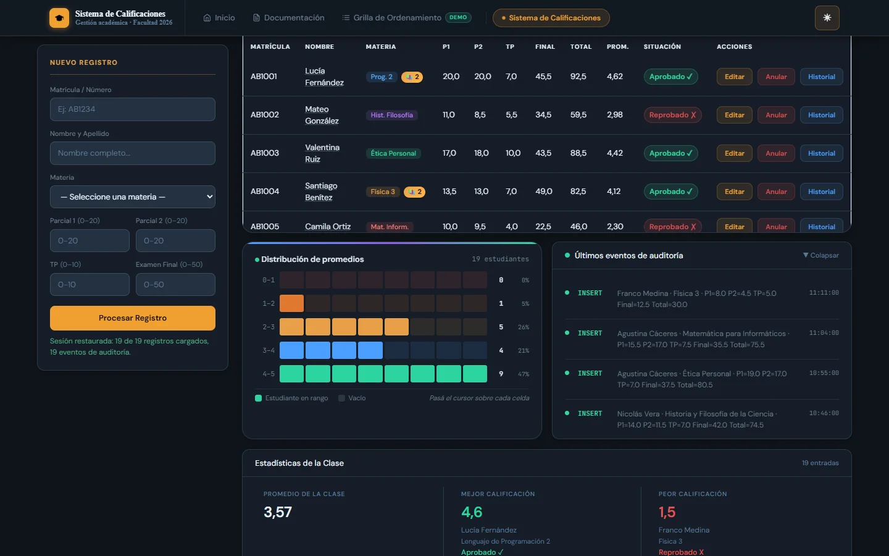
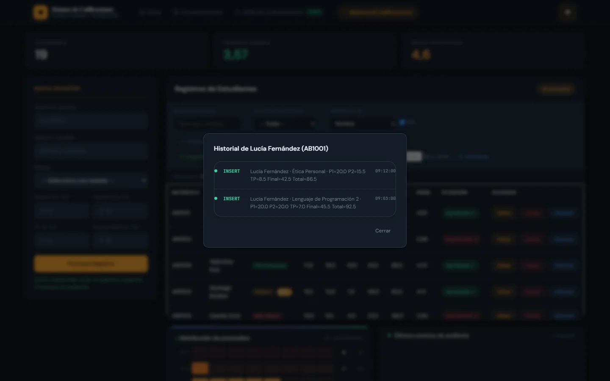
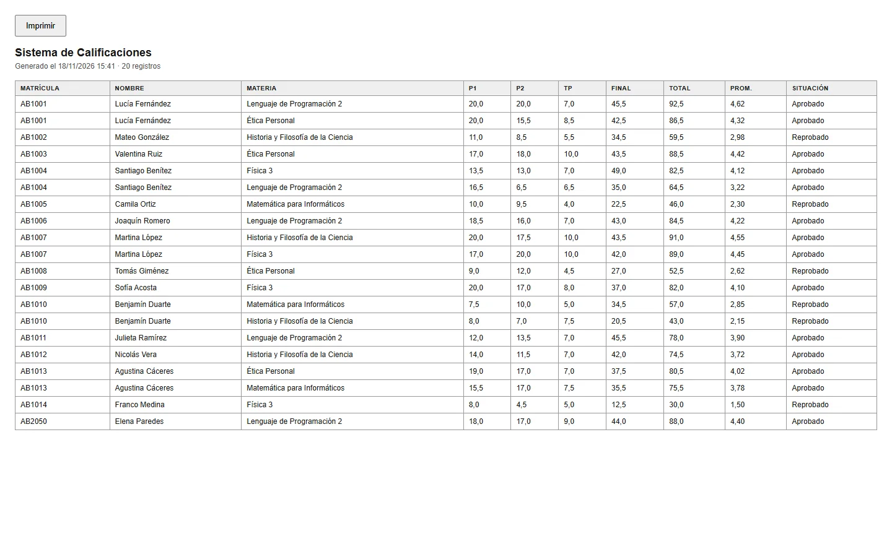
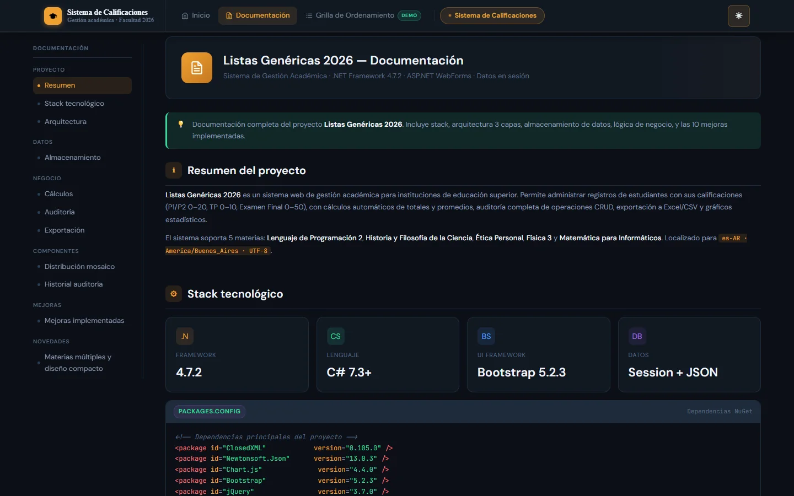

<div align="center">

# Sistema de Calificaciones Académicas

Aplicación web en **ASP.NET Web Forms** para registrar estudiantes y sus calificaciones por materia, con cálculo automático de promedios, estadísticas del curso, auditoría y exportación a Excel/CSV.




</div>

---

##  Demo

El GIF muestra el flujo principal:
1. Cargar un estudiante con sus notas.
2. Ver cómo se actualizan el contador, el promedio general y la distribución.
3. Encontrarlo con la búsqueda rápida.

- **Probar en local:** ver [Correr en local](#-correr-en-local). Lleva unos 2 minutos con Visual Studio.
- **Publicar online:** la app se puede alojar gratis en un hosting con IIS. Ver la [guía de despliegue](docs/DESPLIEGUE.md).
- **Datos de ejemplo:** [`docs/demo/respaldo-demo.json`](docs/demo/respaldo-demo.json) trae 14 alumnos ficticios. Se carga con el botón **Restaurar** de la sección *Sesión (backup)*.

##  Funcionalidades

- **Alta, edición y baja** de registros con validación por campo:
  - Parciales: de 0 a 20.
  - TP: de 0 a 10.
  - Examen final: de 0 a 50.
- **Cálculo automático** del total, el promedio en escala 0–5, la nota en palabras y la situación (Aprobado o Reprobado).
- **5 materias**:
  - Lenguaje de Programación 2
  - Historia y Filosofía de la Ciencia
  - Ética Personal
  - Física 3
  - Matemática para Informáticos
- **Varias materias por alumno**:
  - Se valida que no se repita la combinación matrícula + materia.
  - La grilla muestra un badge con la cantidad de materias y un popover para cambiar entre ellas.
- **Búsqueda, filtro por materia y ordenamiento** en la grilla.
- **Estadísticas del curso**:
  - Promedio general, mejor y peor calificación.
  - Distribución de promedios en un mosaico por rangos, hecho con JavaScript puro.
- **Auditoría** de cada alta, edición y baja:
  - Panel con los últimos eventos.
  - Historial por alumno.
  - Descarga del log completo.
- **Exportación** a Excel (ClosedXML) y CSV, respetando los filtros activos.
- **Importación** desde planilla, con vista previa antes de confirmar.
- **Respaldo de la sesión** en JSON (guardar y restaurar) y **vista de impresión**.
- **Tema claro/oscuro** y localización `es-AR`.

##  Capturas

| Inicio | Panel principal |
|---|---|
|  |  |
| **Grilla de estudiantes** | **Distribución y auditoría** |
|  |  |
| **Historial del alumno** | **Vista de impresión** |
|  |  |

La app incluye además una página de **documentación técnica** (`/About`):



##  Arquitectura

Arquitectura en **3 capas** dentro de una solución de Visual Studio:

```
┌──────────────────────────────┐
│  Presentación  (Datos/)      │  ASPX + Site.Master + code-behind
│  Calificaciones.aspx, ...    │  GridView, validadores, JS del mosaico
└──────────────┬───────────────┘
               │ usa
┌──────────────▼───────────────┐
│  Lógica de negocio  (BLL/)   │  Fachada: Calculos, AuditLogger
│                              │  Procesos: PersonasService
│                              │  DTO: InfoDatosPersonales, AuditEntry, SesionBackup
└──────────────┬───────────────┘
               │ guarda en
┌──────────────▼───────────────┐
│  Session de ASP.NET          │  List<InfoDatosPersonales>, List<AuditEntry>
│  + respaldo JSON (opcional)  │  Newtonsoft.Json
└──────────────────────────────┘
```

> El proyecto de presentación se llama `Datos` por cómo se creó la solución; contiene las páginas web. La lógica está en `BLL` y la usan tanto la web como la app de consola.

##  Almacenamiento de datos

El sistema **no usa base de datos**. Trabaja con listas genéricas en memoria, guardadas en la sesión del usuario:

| Clave de sesión | Contenido |
|---|---|
| `Session["ListaPersonas"]` | `List<InfoDatosPersonales>`: estudiantes con sus notas por materia |
| `Session["AuditLog"]` | `List<AuditEntry>`: historial de operaciones INSERT / UPDATE / DELETE |

Los datos duran mientras esté abierta la sesión del navegador. Para conservarlos se usa el **respaldo JSON** (`SesionBackup`), que exporta alumnos y auditoría a un archivo y permite restaurarlos más tarde. Los archivos Excel y CSV se generan en memoria (`MemoryStream`) y se envían al navegador sin escribir en el disco del servidor.

##  Lógica de cálculos

Toda la lógica está en `BLL/Fachada/Calculos.cs`:

| Cálculo | Fórmula |
|---|---|
| Total | `P1 + P2 + TP + Examen final` (máximo 100) |
| Promedio | `(Total / 100) × 5`, en escala 0–5 con 2 decimales |
| Nota en palabras | ≥ 4,5 Cinco · ≥ 3,5 Cuatro · ≥ 2,5 Tres · ≥ 1,5 Dos · menor, Uno |
| Situación | **Aprobado** si el promedio es ≥ 3 (60% del puntaje), si no **Reprobado** |

```csharp
public static decimal CalcularPromedio(decimal total)
{
    return Math.Round((total / 100m) * 5m, 2);
}

public static string ObtenerSituacion(decimal notaFinal)
{
    return notaFinal >= 3m ? "Aprobado" : "Reprobado";
}
```

##  Tecnologías

| Capa | Tecnologías |
|---|---|
| **Framework** | .NET Framework 4.7.2, ASP.NET Web Forms, FriendlyUrls |
| **Lenguaje** | C# 7.3 |
| **Interfaz** | Bootstrap 5.2.3, CSS propio con tema claro/oscuro, JavaScript |
| **Excel** | ClosedXML 0.105 |
| **JSON** | Newtonsoft.Json 13 |
| **Dependencias** | NuGet (`packages.config`) |

##  Estructura

```
Gestion_calificaciones/
├── LIstas genericas 2026.sln
├── Datos/                        # Proyecto web (presentación)
│   ├── Default.aspx              # Portada
│   ├── Calificaciones.aspx(.cs)  # Sistema principal: formulario, grilla, estadísticas
│   ├── About.aspx                # Documentación técnica
│   ├── Contact.aspx              # Demo de la grilla de ordenamiento
│   ├── Imprimir.aspx             # Vista de impresión
│   ├── Site.Master               # Layout, navegación y tema
│   ├── Content/                  # Estilos propios + Bootstrap
│   └── Properties/PublishProfiles/Carpeta.pubxml
├── BLL/                          # Lógica de negocio
│   ├── Fachada/                  # Calculos, AuditLogger
│   ├── Procesos/                 # PersonasService (materias y validaciones)
│   └── DTO/                      # InfoDatosPersonales, AuditEntry, SesionBackup...
├── LIstas genericas 2026/        # Versión de consola que usa la misma BLL
└── docs/                         # Capturas, datos de demo y guía de despliegue
```

##  Correr en local

**Requisitos:** Windows con **Visual Studio 2019/2022** y la carga de trabajo **ASP.NET y desarrollo web**, que incluye .NET Framework 4.7.2 e IIS Express.

1. Cloná el repositorio:
   ```bash
   git clone https://github.com/vecs0/Gestion_calificaciones.git
   ```
2. Abrí `LIstas genericas 2026.sln`. Visual Studio restaura los paquetes NuGet al compilar.
3. Elegí **Datos** como proyecto de inicio y presioná **F5**. Se abre en IIS Express.
4. Entrá a **Sistema de Calificaciones** y, si querés datos de ejemplo, restaurá `docs/demo/respaldo-demo.json`.

Para la versión de consola, elegí **LIstas genericas 2026** como proyecto de inicio.

> **Smart App Control (Windows 11):** ASP.NET compila ensamblados en `Temporary ASP.NET Files`. Si Windows los bloquea (error `0x800711C7`), desactivá Smart App Control o precompilá la aplicación.

##  Despliegue

La app necesita **Windows + IIS**: no funciona en hostings estáticos como GitHub Pages. La [guía de despliegue](docs/DESPLIEGUE.md) explica cómo generar la carpeta `publish/` y subirla gratis a **MonsterASP.NET** o **Azure App Service (F1)**.

##  Documentación

Dentro de la app, la página **Documentación** (`/About`) detalla:
- la arquitectura;
- los cálculos;
- el sistema de auditoría;
- la exportación;
- el mosaico de distribución;
- las mejoras implementadas.

La página **Grilla de Ordenamiento** (`/Contact`) explica cómo funciona el ordenamiento del GridView.

##  Versiones

| Versión | Fecha | Cambios |
|---|---|---|
| **v1.1.0** | Noviembre 2026 | Portada propia, página principal renombrada a `Calificaciones`, corrección del menú activo, documentación alineada con el código, perfil de publicación, datos de demo y capturas |
| **v1.0.0** | Mayo 2026 | Sistema completo: capas de presentación y BLL, y app de consola |

##  Autor

<table>
  <tr>
    <td></td>
    <td>
      <strong>Victor Emmanuel Cabrera Sosa</strong><br>
      <a href="https://github.com/vecs0">vecs0 · github.com/vecs0</a>
    </td>
  </tr>
</table>

##  Licencia

Distribuido bajo la licencia **MIT**. Consultá el archivo [LICENSE](LICENSE) para el texto completo.

| Permisos | Condiciones | Limitaciones |
|---|---|---|
| ✔ Uso comercial<br>✔ Modificación<br>✔ Distribución<br>✔ Uso privado | Incluir el aviso de copyright y la licencia | ✖ Sin garantía<br>✖ Sin responsabilidad |

**Contenido de terceros:** Bootstrap, jQuery, ClosedXML, Newtonsoft.Json y los paquetes de ASP.NET se distribuyen bajo sus propias licencias (MIT o Apache 2.0). Los alumnos de los datos de demo son ficticios.

© 2026 Victor Emmanuel Cabrera Sosa
